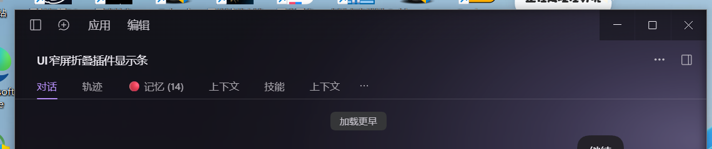
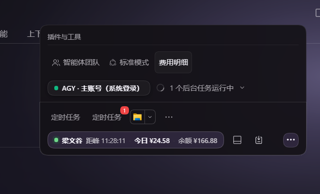

# dsh-header-collapse

会话头栏的插件胶囊太多时（智能体团队、创造模式、费用明细、峰谷、今日金额、余额……），
窄窗口下会被挤成一团。本插件把它们收进一枚「⋯」，点开（左键或右键都可以）是一张
排版宽松的二级面板。

## 行为

| 窗口宽度 | 表现 |
| --- | --- |
| 宽（放得下标题 + 全部胶囊） | 什么都不做，胶囊照旧平铺 |
| 窄（放不下） | 只留「⋯」，其余胶囊收起 |
| 点「⋯」/ 右键「⋯」 | 浮层面板，胶囊在里面自由换行 |
| 再点一次 / Esc / 点面板外 | 收起 |
| 拖动窗口、拖动侧栏改宽 | 自动重新判断（带 48px 滞回，不会临界抖动） |

二级面板把两个插槽容器叠成一张卡片：

- `conversation.session.header.actions`（智能体团队、创造模式、费用明细……）
- `conversation.session.header.utilities`（定时任务、峰谷、更多插件……）

面板宽 280–440px，最大高 56vh，超出内部滚动；标题条只出现一次；
上下两段拼成一个圆角矩形，投影只落在最下面那段。

## 效果

| 折叠态（窄窗只剩「⋯」） | 展开的二级面板 |
| --- | --- |
|  |  |

宽窗下胶囊照旧平铺：

## 实现要点

- 只注册一个插槽条目 `conversation.session.header.utilities`（`order: 999`，排在所有胶囊之后），
  渲染那枚「⋯」按钮。**不改宿主代码，不 import `dsh-client-ui-primitives`。**
- 折叠/展开全走 CSS：在 `<html>` 上打 `data-hc="collapsed" | "open"`，
  面板态把两个容器改成 `position: fixed`。**真实胶囊原地变成面板内容**，
  所以点击、悬停、popover 全部照常工作，不是截图/克隆出来的死控件。
- 定位不依赖宿主哈希类名（`an3WzG_*` 会随构建变），只靠 DOM 父子关系：
  `.titleRow → [.titleCluster(crumbs + actions), .headerUtilities]`，
  而本插件的按钮就在 `.headerUtilities` 里。
- 宽窄判定是实测的：临时撤掉折叠态，把胶囊摊平量 `offsetWidth` 求和，
  与 `titleRow.clientWidth` 比较，并给标题保留 ≥100px。所以胶囊文案变长、
  插件增减都不需要改阈值。
- 样式只用 `--dsw-*` 主题变量，亮/暗主题都跟随；样式标签带 `data-plugin`，
  插件卸载时随 `ctx.effect` 一起移除。

## 安装

已经在 `C:/Users/user\.dsh\profiles\desktop` 里接好（junction + 一行 patch）：

```yaml
# ── dsh-header-collapse ──
- insert:
    - id: header-collapse
      name: dsh-header-collapse
# ── /dsh-header-collapse ──
```

改完**不用重启 DeepSeek Harness**：宿主自带的 `@deepseek-ai/dsh-client-hmr` 每 500ms
`statSync` 一遍已挂载的客户端 bundle，改了 `lib/client.js` 就会推一次 rebuilt，
页面（Ctrl+R）重载后即生效。只有**第一次新增插件**（模块图里还认不出这个包）才需要重启。

## 卸载

删掉 profile `cordis.patch.yml` 里上面那个块，再删 `node_modules\dsh-header-collapse`
这个 junction，重启即可。源码目录 `E:\工作区\dsh-plugins\dsh-header-collapse` 可以留着。
